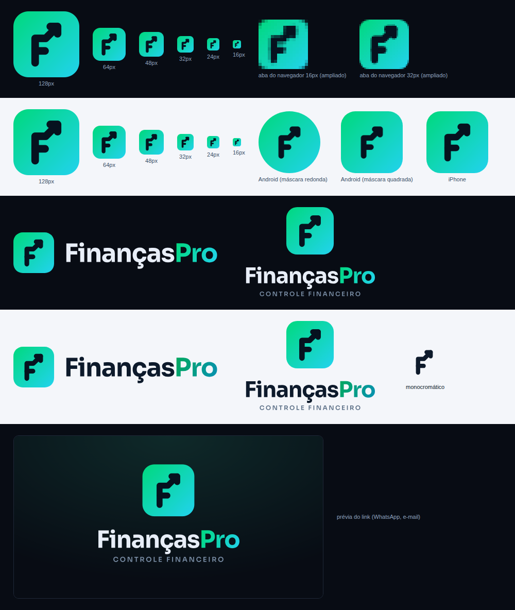

# Marca FinançasPro

## Símbolo — "F que decola"

Um **F** cuja perna de cima vira uma **seta subindo**: as finanças sob controle e crescendo.
Desenhado numa grade de 100 × 100, com traço arredondado, sobre um quadrado com cantos
arredondados no gradiente da marca.

## Arquivos

| Arquivo | Uso |
|---|---|
| `simbolo.svg` | Símbolo (ícone do app) — uso geral |
| `simbolo-monocromatico.svg` | Só o desenho, em uma cor (`currentColor`) — carimbos, impressão, marca-d'água |
| `logo-fundo-escuro.svg` / `logo-fundo-claro.svg` | Logotipo horizontal (símbolo + nome) |
| `logo-vertical-fundo-escuro.svg` / `logo-vertical-fundo-claro.svg` | Logotipo vertical com a assinatura "Controle financeiro" |
| `png/` | Os mesmos em PNG, em alta resolução, para usar fora do sistema (perfil, documentos, mensagens) |
| `../favicon.svg`, `../favicon.ico` | Ícone da aba do navegador (versão reforçada para 16–48 px) |
| `../icons/` | Ícones do app: iPhone (`apple-touch-icon.png`), Android/PWA (192, 512 e *maskable*) e a imagem de prévia do link (`og-image.png`) |
| `../manifest.webmanifest` | Nome, cores e ícones usados ao adicionar o sistema à tela inicial |

Os logotipos SVG têm o texto convertido em curvas: aparecem iguais em qualquer computador,
mesmo sem a fonte instalada.

## Cores

| Cor | Hex | Uso |
|---|---|---|
| Verde | `#00d97e` | Início do gradiente |
| Ciano | `#22d3ee` | Fim do gradiente |
| Tinta | `#06121f` | Desenho do F sobre o gradiente |
| Fundo escuro | `#080c14` | Fundo do app e do ícone instalado |
| Verde (fundo claro) | `#00a85e` | "Pro" sobre fundo claro |
| Ciano (fundo claro) | `#0891b2` | "Pro" sobre fundo claro (o ciano normal fica fraco no branco) |

Gradiente sempre na diagonal, do verde (canto superior esquerdo) ao ciano (canto inferior direito).

## Tipografia

**Sora** (Google Fonts) — a mesma do sistema. Nome em *Bold* (700) com espaçamento levemente
fechado; assinatura "CONTROLE FINANCEIRO" em *SemiBold* (600), maiúsculas, espaçada.

## Regras de uso

- **Área livre:** deixe em volta do logotipo um espaço de pelo menos ¼ da altura do símbolo.
- **Tamanho mínimo:** símbolo com 16 px (use `favicon.svg`); logotipo horizontal com 120 px de largura.
- **Fundo:** use a versão "fundo escuro" em fundos escuros e a "fundo claro" nos claros.
- **Não** distorcer, girar, trocar as cores do gradiente, aplicar sombra pesada ou contorno.

## Observação sobre "adicionar à tela inicial"

O manifesto usa `"display": "minimal-ui"`. No Android e no computador o FinançasPro pode ser
instalado como app e usa os mesmos dados do navegador. No iPhone, o atalho da tela inicial abre
no Safari — de propósito: no iOS um app "em tela cheia" guarda os dados separados do Safari, e
como o FinançasPro salva tudo no navegador, os lançamentos pareceriam ter sumido.
